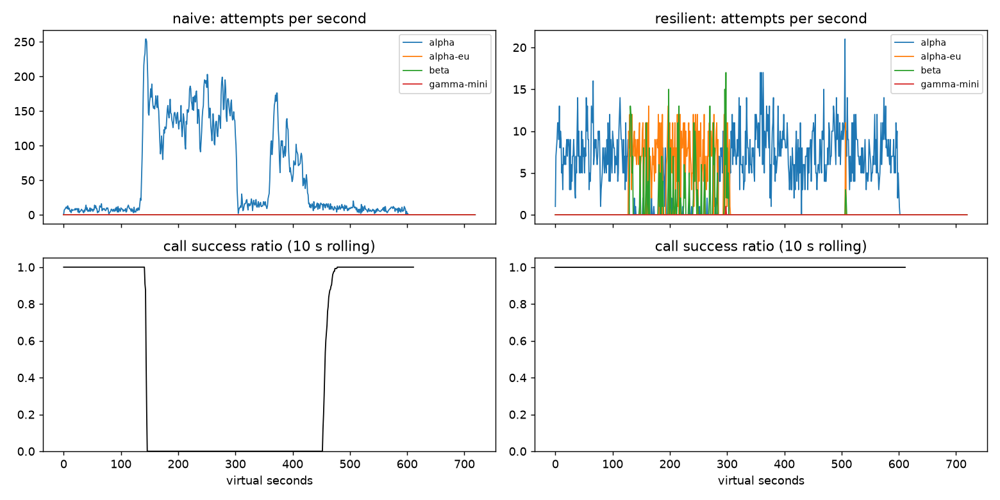

# Lab 25B — Report

**Họ tên:** PHẠM ĐÌNH BẢO KHÔI · **Mã học viên:** 2A202602434 · **Ngày:** 13/10/2026.

**Commit:** chia riêng theo Part A–G; xem `git log --oneline`. **Điểm tự động:** 84/88 với seed 25, 26, 27. Đã đạt toàn bộ 84 điểm có thể kiểm chứng tại máy; 4 điểm SLO hidden cần dữ liệu giảng viên. Part F có tối đa 12 điểm chấm tay, chưa tự nhận điểm. Các băng ẩn của C/G chưa được kiểm chứng.

82 test gốc và 11 test bổ sung PASS, tổng 93. Nguồn số: `gameday/*.json`, `cache/*.json`, `workflows.json`, `slo.json`, `scoreboard.json`, `experiments.json`. Cách thực hiện và chạy lại: [LAB_WALKTHROUGH.md](../docs/LAB_WALKTHROUGH.md).

## 1. Kết quả Game Day

Seed 25; availability là tỷ lệ lượt user tốt; p95 chỉ tính lượt thành công.

| Băng | Client | availability | p95 (s) | amplification | retry_ratio | cost/turn | recovery (s) | PASS? |
|---|---|---:|---:|---:|---:|---:|---:|:---:|
| G1 | naive | 0.7194 | 7.157 | 7.738 | 6.738 | 2.163 | 4 | FAIL |
| G1 | resilient | 1.0000 | 4.809 | 1.065 | 0.002 | 2.107 | 0 | PASS |
| G2 | naive | 0.4560 | 15.034 | 9.904 | 8.904 | 4.627 | 155 | FAIL |
| G2 | resilient | 1.0000 | 6.256 | 1.041 | 0.008 | 2.124 | 0 | PASS |
| G3 | naive | 1.0000 | 4.768 | 1.164 | 0.164 | 2.328 | 0 | FAIL |
| G3 | resilient | 1.0000 | 4.612 | 1.054 | 0.025 | 2.127 | 0 | PASS |
| G4 | naive | 1.0000 | 13.764 | 1.004 | 0.004 | 2.008 | 0 | FAIL |
| G4 | resilient | 1.0000 | 5.481 | 1.035 | 0.004 | 2.115 | 0 | PASS |
| G5 | naive | 0.3699 | 5.359 | 17.030 | 16.030 | 2.124 | N/A | FAIL |
| G5 | resilient | 0.8179 | 5.471 | 1.004 | 0.003 | 2.505 | N/A | PASS |
| G6 | naive | 0.5170 | 4.836 | 12.344 | 11.344 | 2.009 | 0 | FAIL |
| G6 | resilient | 1.0000 | 6.413 | 1.065 | 0.026 | 2.188 | 0 | PASS |

G1–G6 PASS mọi check trên cả seed 25/26/27 trong grader. A–C cũng PASS 18/18 lượt dịch cửa sổ sự cố +17 giây. `recovery_s = 0` đo thành công của call qua cả fallback; không đồng nghĩa primary không lỗi. G5 không có restore nên recovery là N/A.

## 2. Cấu hình client và lý do

| Tham số | Giá trị | Lý do và bằng chứng |
|---|---:|---|
| attempt_timeout_s | 5.0 | G2 p95 6.256, thay vì 10.023 ở cấu hình starter timeout 8 và budget lớn hơn. G6 timeout 30 làm availability xuống 0.9488, dưới 0.95. |
| max_attempts_per_provider | 2 | Tối đa một retry transient mỗi provider; G2 amplification 1.041, dưới 1.6. |
| min_time_left_s | 1.0 | Không cấp attempt thiếu thời gian; test deadline và release probe PASS. |
| backoff_base_s / cap_s | 0.25 / 4.0 | Full jitter có giới hạn, retry-after cộng jitter riêng; G1 có 0 vi phạm retry-after. |
| retry_budget_ratio / min_per_s / max_tokens | 0.05 / 0.1 / 20 | G3 retry_ratio 0.025. Nếu breaker hỏng, bật budget giữ G2 amplification 1.375 thay vì 1.799. Token ban đầu và refill khiến tỷ lệ không phải trần tuyệt đối 5%. |
| quota_cooldown_s | 300 | Tránh gọi account hết quota; G5 availability 0.8179, không retry lỗi client. |
| breaker.window_size / min_calls | 20 / 10 | Dùng kết quả gần nhất, tránh trip vì vài mẫu; G2 đạt recovery và primary-share check cả ba seed. |
| breaker.failure_rate_threshold | 0.5 | G3 brownout không thành retry storm: availability 1.0, retry_ratio 0.025. |
| breaker.slow_call_s / slow_rate_threshold | 5.0 / 0.6 | Test slow success/probe PASS. Timeout cũng 5 giây nên call lâu hơn thường vào failure rate; G4 p95 5.481, dưới 10. |
| breaker.open_duration_s | 10.0 | Probe để trở lại primary; mọi check G2/G4 PASS cả ba seed. |
| breaker.half_open_max_probes / successes | 2 / 2 | Giới hạn probe đang bay; test probe cap, lỗi/chậm, generation cũ và cancel PASS. |

Tham số breaker được giữ sau kiểm chứng, chưa chứng minh tối ưu. Thay timeout và budget cùng lúc trong vòng tinh chỉnh A–C nên không tách quan hệ nhân quả từng tham số từ số starter/final.

| Loại lỗi | Ghi breaker? | Retry? | Failover / cooldown |
|---|---|---|---|
| CLIENT_ERROR | Không, release | Không | GiveUp; request sai không cứu bằng đổi provider |
| QUOTA_EXHAUSTED | Không, release | Không | Cooldown 300 giây, failover ngay |
| RATE_LIMITED | Không, release | Không ngay | Cooldown shared đến retry-after, failover; khi hết lựa chọn chỉ chờ cooldown ngắn ≤5 giây nếu đủ deadline |
| OVERLOADED / SERVER_ERROR / TIMEOUT | Có | Khi còn attempt, budget, deadline và breaker cho phép | Nếu không retry được, chuyển provider tiếp theo |

`ladder(tool)` lọc capability. `tries` đếm riêng mỗi provider. Generation cũ bị bỏ qua; cancel và lỗi không phản ánh health trả probe slot.

## 3. Ba thí nghiệm client

Tái tạo bằng `scripts/run_experiments.py`, seed 25; chỉ sửa bản sao cấu hình trong bộ nhớ.

### 3.1. Retry budget khi breaker cấu hình sai

Đặt `min_calls=1000000000`, `max_attempts_per_provider=5`. Tắt budget bằng ratio 100, max tokens 1e9, refill 1e6.

| Băng | Breaker / budget | availability | amplification | retry_ratio | recovery (s) |
|---|---|---:|---:|---:|---:|
| G2 | Bình thường | 1.0000 | 1.041 | 0.008 | 0 |
| G2 | Breaker hỏng, budget bật | 0.9992 | 1.375 | 0.028 | 0 |
| G2 | Breaker hỏng, budget tắt | 0.9581 | 1.799 | 0.516 | 66 |
| G3 | Bình thường | 1.0000 | 1.054 | 0.025 | 0 |
| G3 | Breaker hỏng, budget bật | 1.0000 | 1.125 | 0.030 | 0 |
| G3 | Breaker hỏng, budget tắt | 1.0000 | 1.164 | 0.163 | 0 |

Budget giới hạn retry tổng kể cả khi breaker không trip. G2 bỏ budget làm amplification vượt 1.6 và recovery vượt 30 giây; G3 retry_ratio vượt 0.10. Breaker tốt giảm traffic gửi tới provider hỏng, còn budget chặn lượng retry trước khi đủ mẫu hoặc khi lỗi phân tán giữa nhiều provider. Vì hai lớp xử lý hai thời điểm và phạm vi khác nhau nên vẫn cần cả hai.

### 3.2. Timeout 30 giây

| Băng | Timeout | availability | p95 thành công (s) |
|---|---:|---:|---:|
| G4 | 5 | 1.0000 | 5.481 |
| G4 | 30 | 1.0000 | 5.608 |
| G6 | 5 | 1.0000 | 6.413 |
| G6 | 30 | 0.9488 | 5.463 |

G4 vẫn PASS nhờ breaker ghi nhận thành công chậm; timeout dài không luôn làm mọi metric hỏng. G6 có deployment treo: timeout 30 chiếm gần hết deadline của user, không còn thời gian fallback nên availability FAIL. p95 G6 thấp hơn ở timeout 30 vì chỉ đo lượt thành công, loại các lượt đã thất bại; không thể dùng nó để kết luận trải nghiệm tốt hơn. Timeout cần dựa trên phân phối latency khỏe, deadline toàn lượt và số bước/fallback còn lại.

### 3.3. Bỏ lọc tool calling

Subclass chỉ dùng trong experiment trả toàn bộ ladder. G6 có **252 incompatible routes**, availability giảm từ **1.0000 xuống 0.8943**; bản chuẩn có 0 route không tương thích. Với người dùng, model dự phòng có thể viết văn bản nhưng không thực hiện được thao tác cần thiết để hoàn tiền. Đổi model mà không kiểm tra khả năng khiến lượt hỗ trợ thất bại, dù endpoint dự phòng còn hoạt động.

## 4. Workflow hoàn tiền

500 session, seed 25, cùng fault profile.

| Executor | completion | crashes | duplicate refunds | duplicate emails | lost refunds | overpaid (cent) | wasted LLM / crash |
|---|---:|---:|---:|---:|---:|---:|---:|
| naive | 1.0000 | 81 | 128 | 81 | 0 | 1574200 | 1.123 |
| yours | 1.0000 | 66 | 0 | 0 | 0 | 0 | 0.303 |

Idempotency key ổn định theo `(session_id, step)` bảo đảm retry/restart của payment và email dùng cùng key. Checkpoint lưu kết quả **sau** khi step thành công; worker mới tải kết quả đã có rồi tiếp tục. JSON tuple trong key tránh va chạm do dấu phân cách và prefix tách effect khỏi checkpoint.

Chỉ idempotency key không ngăn chạy lại LLM và lookup sau crash, làm tốn chi phí. Chỉ checkpoint không bảo vệ khoảng trống payment đã chuyển tiền nhưng response/checkpoint chưa được lưu: retry có thể chuyển lần nữa. Ghi checkpoint trước payment có thể đánh dấu hoàn thành rồi crash trước khi tiền đi, dẫn đến mất hoàn tiền. Executor chỉ retry ServiceError/ServiceTimeout, không bắt WorkerCrash hay IdempotencyConflict. Grader đạt các tiêu chí workflow trên cả ba seed.

## 5. Alerting và error budget

Prefix sums cho mỗi truy vấn cửa sổ O(1); mỗi rule yêu cầu đồng thời long và short window. Episode kết thúc ở phút đầu tiên rule không còn firing, hoặc cuối chuỗi. So sánh gần bằng với tolerance nhỏ để ngưỡng chính xác không bị sai do biểu diễn số thực.

| Sự cố | Mong đợi | Naive | Burn-rate | Độ trễ burn-rate (phút) |
|---|---|---|---|---:|
| checkout_bug | page | page, trễ 1 | page | 27 |
| provider_outage | page | page, trễ 0 | page | 4 |
| deploy_blip | none | false page | không page | N/A |
| slow_leak | ticket | không phát hiện | ticket, không page | 1337 |
| degraded_evening | page | page, trễ 214 | page | 291 |
| night_spike | none | false page | không page | N/A |
| small_bump | none | false page | không page | N/A |

Burn-rate: **3 page, 1 ticket, 0 false page**, public PASS. Naive: 7 page, 3 false page, bỏ sót slow leak.

30 ngày có 25,901,755 request, 55,618 bad. Budget cho SLO 99.5% là **129,508.8** bad request (làm tròn 1 chữ số); availability **0.997853**. Đã tiêu **42.95%**, còn **57.05%**, nên **không freeze release** theo rule của lab. Trạng thái này chưa xác nhận trên dữ liệu SLO hidden.

`small_bump` 20 phút ở 12% lỗi tương đương burn 24× trong đoạn sự cố, nhưng khi trải trên 60 phút chỉ khoảng 8× nếu traffic đều, dưới fast-page 14.4×; cửa sổ 6 giờ còn thấp hơn. Luật đa cửa sổ nhận diện tốc độ tiêu budget đủ lớn và còn tiếp diễn, tránh gọi on-call vì blip ngắn. Quyết định thực tế dùng tổng request có trọng số, không lấy trung bình đơn giản các tỷ lệ phút.

## 6. Postmortem G2 — naive client

### Tóm tắt và ảnh hưởng

Provider alpha giảm 75% năng lực trong khoảng t=120–300 giây. Ba tầng retry của naive client khuếch đại 3,481 logical call thành **34,475 attempt**, amplification **9.904**. Provider hồi phục ở t=300 nhưng metric recovery còn **155 giây**, do vòng lặp retry và hàng đợi công việc cũ.

Trong 600 giây workload có **2,362 lượt**, **1,077 tốt**, **1,285 thất bại** (54.40%). Khoảng từ trigger tới đầu cửa sổ phục hồi đo được là **335 giây**; đây không phải khẳng định mọi giây trong khoảng đều có tỷ lệ lỗi 100%. Giả sử tháng chỉ có sự cố này và traffic đều 4 lượt/giây: 30 ngày có 10,368,000 lượt, budget 0.5% = 51,840 lượt; sự cố tiêu **2.48% budget tháng**, không làm cạn budget. Giả định volume này tách biệt bộ SLI 30 ngày ở mục 5.

### Timeline từ CSV

Attempts/s là trung bình alpha trên 10 giây `[t-9,t]`; success ratio = tổng calls_ok / calls_done cùng cửa sổ, khác metric recovery dùng cửa sổ 30 giây nhìn về phía trước.

| t (s) | Sự kiện / quan sát | attempts/s | calls_ok / calls_done | success ratio |
|---:|---|---:|---:|---:|
| 110 | Trước sự cố | 6.7 | 73 / 73 | 1.000 |
| 120 | Bắt đầu mất năng lực; cửa sổ còn chủ yếu kết quả trước sự cố | 9.1 | 90 / 90 | 1.000 |
| 150 | Retry storm đã hình thành | 208.9 | 0 / 50 | 0.000 |
| 200 | Retry giữ tải cao | 139.6 | 0 / 38 | 0.000 |
| 300 | Provider hồi phục nhưng client vẫn thất bại | 142.9 | 0 / 43 | 0.000 |
| 330 | Tải giảm tạm thời nhưng chưa có call tốt | 14.2 | 0 / 27 | 0.000 |
| 400 | Storm tái tăng sau restore | 76.2 | 0 / 49 | 0.000 |
| 455 | Bắt đầu cửa sổ 30 giây thỏa metric recovery; cửa sổ 10 giây quá khứ vẫn thấp | 13.5 | 12 / 40 | 0.300 |
| 480 | Thành công ổn định trong cửa sổ quan sát | 8.8 | 137 / 137 | 1.000 |

### Trigger, root cause và cơ chế tự duy trì

Trigger là mất GPU ở provider; root cause phía client là retry app × gateway × SDK, delay cố định, thiếu jitter/budget/breaker và fallback. Client timeout không hủy xử lý phía server. Request mà user đã bỏ vẫn chiếm slot/hàng đợi; retry bổ sung tiếp tục vượt năng lực, tạo thêm timeout và retry. Vì vậy restore GPU không lập tức xóa backlog hoặc vòng lặp tải.

Naive còn có 26,298 lỗi rate limit và 28,381 vi phạm retry-after. Đây là thiếu kiểm soát phối hợp trong thiết kế và quy trình kiểm thử, không quy lỗi cá nhân. Simulator lặp được giúp nhận diện vòng lặp; cấu hình resilient giữ amplification 1.041, availability 1.0 và recovery 0 trên cùng seed nhờ fallback và giới hạn tải.

### Action items đề xuất

| # | Hành động | Loại | Owner (vai trò) | Cách kiểm chứng |
|---|---|---|---|---|
| 1 | Bắt buộc một tầng retry có budget, jitter và tôn trọng retry-after | prevent | Client platform | G1 violations = 0; G2 amplification ≤1.2 trên ba seed trong CI |
| 2 | Theo dõi amplification, queue latency và burn rate | detect | SRE/on-call | Replay G2 và SLI: 0 false page, mọi sự cố lớn được phát hiện đúng hạn |
| 3 | Duy trì breaker, probe cap và fallback có kiểm tra tool | mitigate | Agent platform | G2 recovery ≤30 giây, primary share ≥0.8; G6 incompatible_routes = 0 |
| 4 | Thêm drill worker chết sau payment | prevent | Workflow/backend | 500 session ×3 seed: 0 duplicate/lost refund, completion ≥99% |

Các owner là vai trò đề xuất, chưa phải phân công thực tế. Chưa cấu hình CI mới cho các drill bổ sung.

## 7. Điểm yếu còn lại

C1 availability tổng chỉ **0.9124** dù FAQ availability **0.9645**, vì workflow/tool và câu hỏi cá nhân vẫn cần provider sống. Cache không thể cứu những yêu cầu này an toàn. Hướng tiếp theo là hàng đợi có trạng thái pending cho nghiệp vụ cho phép chờ, thêm nguồn dự phòng độc lập và hiển thị rõ degraded/stale; chưa triển khai ngoài yêu cầu lab.

G2 seed 26 p95 còn 8.250 giây; request vào hàng đợi trước khi breaker trip vẫn chờ timeout. Timeout ngắn có thể bỏ request hợp lệ và phí xử lý phía server. Ngưỡng semantic 0.94 cần đánh giá lại khi thay embedding/corpus; zero wrong answer trên public không phải bảo đảm tuyệt đối trong production.

## 8. Cache

### So sánh seed 25

| Client | availability | faq_availability | cache_hit_ratio | stale_served | wrong_answers | outdated_answers | cost/turn | PASS? |
|---|---:|---:|---:|---:|---:|---:|---:|:---:|
| resilient | 0.8373 | 0.8424 | 0.000 | 0 | 0 | 0 | 1.386 | FAIL |
| cached | 0.9124 | 0.9645 | 0.590 | 196 | 0 | 2 | 0.957 | PASS |

| Tham số | Cuối | Lý do |
|---|---:|---|
| similarity_threshold | 0.94 | Loại near-miss: 0.80 có 181 other_question, còn 0.94 có 0; 0.97 làm hit xuống 0.499 dưới 0.50. |
| ttl_s | 30 | Giới hạn silent update: outdated 2, so với 3 ở TTL 60 và 95 ở TTL 300. |
| max_stale_s | 300 | Stale chỉ khi GiveUp; FAQ availability 0.9645, so với 0.8506 khi không stale. |
| max_entries | 500 | Giữ giới hạn bộ nhớ; test LRU eviction PASS. Chưa sweep dung lượng để khẳng định 500 tối ưu. |

Cache từ chối câu hỏi cá nhân, scope theo prompt_version, tìm cosine cao nhất, refresh entry tương tự và LRU eviction. Webhook xóa mọi entry có source bị đổi. Khi inner client GiveUp phải lookup lại tại thời điểm hiện tại, tránh dùng hit cũ đã bị invalidation trong lúc provider đang chạy.

### Thí nghiệm ngưỡng

Giữ TTL 30 và stale 300; seed 25.

| Threshold | hit ratio | wrong_answers | cost/turn | faq_availability |
|---:|---:|---:|---:|---:|
| 0.80 | 0.610 | 181 | 1.016 | 0.8593 |
| 0.94 | 0.590 | 0 | 0.957 | 0.9645 |
| 0.97 | 0.499 | 0 | 1.018 | 0.9640 |

181 wrong answers tại 0.80 đều có reason `other_question`. Catalog chứa cặp gần nhưng khác ý như chính sách hoàn tiền/thời gian nhận tiền, đổi size/đổi màu và phí ship nội thành/ngoại tỉnh; embedding gần không có nghĩa câu trả lời hoán đổi được. Metric reason không liệt kê số lỗi từng cặp nên không gán số 181 cho một cặp cụ thể. 0.94 giữ paraphrase hữu ích, 0.97 nghiêm hơn nhưng bỏ nhiều hit đúng.

### Thí nghiệm TTL

Giữ threshold 0.94, stale 300.

| TTL (s) | hit ratio | outdated_answers | faq_availability | cost/turn |
|---:|---:|---:|---:|---:|
| 30 | 0.590 | 2 | 0.9645 | 0.957 |
| 60 | 0.652 | 3 | 0.9645 | 0.915 |
| 300 | 0.731 | 95 | 0.9640 | 0.863 |

Silent update không gửi webhook nên cache không biết source đã thay đổi; TTL buộc refresh khi provider khỏe. Nếu đúng lúc outage, stale window có thể kéo dài thời gian dùng nội dung cũ; stale-if-error là đánh đổi có giới hạn, không phải cách bảo đảm freshness tuyệt đối. Chọn 30 giây để có dư địa dưới ngưỡng outdated ≤15 trên ba seed; TTL 300 tiết kiệm hơn nhưng FAIL.

### Thí nghiệm stale-if-error

Tắt stale (`max_stale_s=0`) làm FAQ availability giảm **0.9645 → 0.8506**, hit **0.590 → 0.476**, stale_served **196 → 0**, wrong vẫn 0. Cache tươi giúp tiết kiệm khi provider khỏe, còn stale có kiểm soát giữ câu trả lời FAQ qua outage. Starter 0.80/600/0 có hit cao 0.742 nhưng 181 wrong và 80 outdated, nên hit ratio cao một mình không chứng minh chất lượng.

Câu hỏi cá nhân không cache kể cả chia theo user: trạng thái order/refund/điểm thay đổi nhanh, cần truy vấn được xác thực và mới nhất; cosine còn có thể trộn các order của cùng người. Khi dashboard xanh nhờ cache, phải theo dõi riêng provider error/timeout, breaker state, số GiveUp trước cache và tỷ lệ stale; giữ user SLI để đo trải nghiệm, không để nó che tình trạng upstream. Những metric bổ sung này là đề xuất observability, không phải dashboard đã được triển khai.
